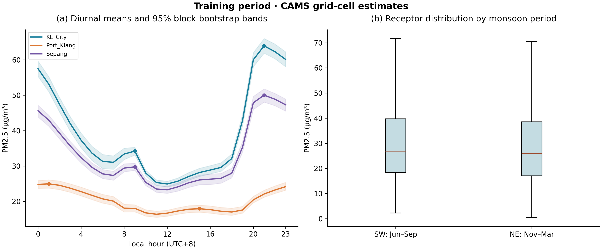
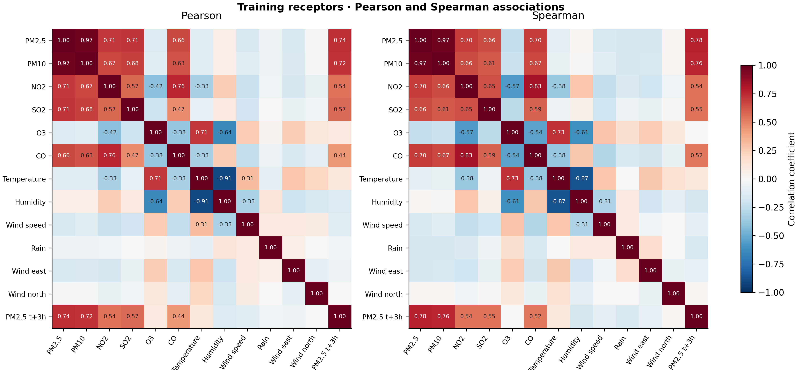
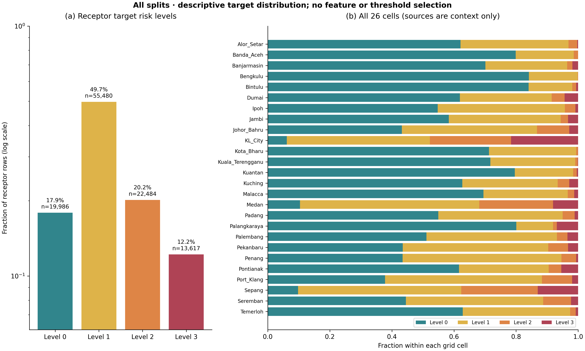
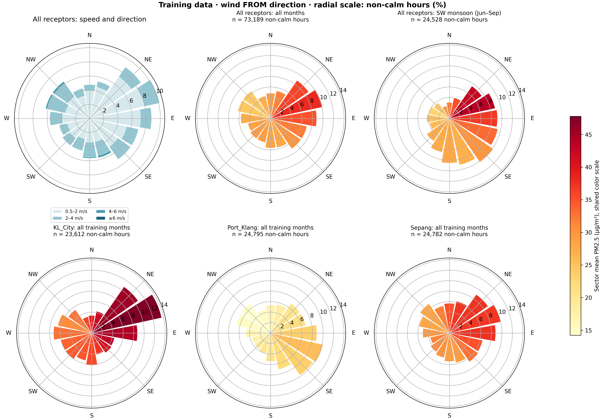
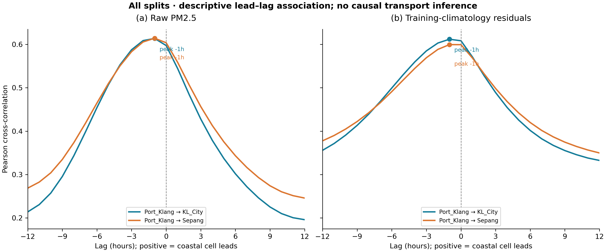

# Exploratory analysis and spatiotemporal features

*Engineering handover draft for verification. Coursework section C.2 requires student authors to write the assessed report independently. Use the verified tables and figures as evidence for that work.*

## 2.3 Exploratory Data Analysis

### Adopted 26 grid data scope

This analysis uses the existing `data/haze_panel_clean.parquet` from upstream revision `2cd57c5`. The input contains 966,677 rows and 35 columns, spanning 4 August 2022 to 31 October 2026 in Kuala Lumpur local time. Its SHA256 matches the upstream manifest. The four upstream Gate 0 checks apply to the existing 26-grid panel. The spatial support checks in QN-001 address the new features separately.

The adopted 26-grid design follows `docs/technical_spec_26grid.md` and the two spatial layers specified in `docs/quality_notice_001.md`. The temporal feature definitions and figure filenames follow the original specification. The 15 km spatial kernel remains the reference for coverage comparisons.

| Item | Current contract | Implemented scope |
|---|---|---|
| Spatial units | 26 registered grid sampling series | Actual IDs, roles, coordinates and series differences checked |
| Main prediction population | Three receptors | KL_City, Port_Klang and Sepang. The other 10 corridors and 13 sources provide context |
| Period | Existing cleaned panel | August 2022 to October 2026 |
| Input path | `data/haze_panel_clean.parquet` | Read-only default. Alternate inputs require explicit arguments |
| Diurnal and wind summaries | Training receptor population | Pooled and per-receptor views, with all-node wind statistics in JSON |
| Cross-correlation pairs | Geometry and role selected candidates | 12 pairs fixed by geometry and role from 75 directed candidates |
| Spatial predictors | Near-field direction and far-field background | 60 km Gaussian scale and 150 km radius for the near field, with separate historical means for source regions |

Historical candidate names and deduplication records document provenance. Runtime pair selection uses current registered sampling coordinates. Exact model grid centres are unverified. The 26-cell distribution supplies network context, while receptor rows define the primary modelling population.

An additional check aligns clean training PM2.5 values by exact timestamp for every pair of the 26 retained cells. None of the 325 pairs is exactly identical on its overlapping training hours. The largest absolute Pearson correlation is 0.9086 for Alor_Setar and Penang, using 26,034 paired hours. No pair reaches the diagnostic threshold of 0.95. This checks series similarity in the delivered panel. The historical discovery file documents duplicate candidate locations before deduplication.

Air quality values are CAMS model estimates obtained through Open-Meteo. Open-Meteo documents the global product at approximately 45 km spatial resolution and three-hour native temporal resolution. The API returns an hourly table. The weather acquisition code uses the archive's default model selection, which combines products. A single weather model or resolution cannot be assigned from the recorded metadata. Operational availability at issue time remains unverified for the retrospective archive. [Open-Meteo air quality documentation](https://open-meteo.com/en/docs/air-quality-api), [historical weather documentation](https://open-meteo.com/en/docs/historical-weather-api).

Figures 1, 2 and 4 use training receptor rows after excluding rows marked as interpolated or still missing. Figure 2 also requires an exact, quality-checked target at t+3h within the same split. Figures 3 and 5 describe all splits. Feature design uses the specified parameters and the separate training-only checks below. `models/metrics_stage2_eda.json` and `models/metrics_stage2_features.json` record the numerical evidence. The EDA JSON now occupies 97,169 bytes, compared with 469,172 bytes before compacting. It retains the displayed statistics, correlation curves and peak counts at their original precision. The five PNG files have the same SHA256 values as before the change.

### Figure 1 Diurnal and monsoon-period distributions

**Observation.** KL_City and Sepang have local maxima at 09:00 and 21:00, whereas Port_Klang has local maxima at 01:00 and 15:00. The southwest-monsoon receptor median is 26.6 µg/m³, compared with 26.0 µg/m³ during the northeast-monsoon months. Their interquartile ranges are 18.3–39.7 and 17.0–38.5 µg/m³, respectively. The seasonal contrast is small in this training sample. The plot does not impose an early-morning and evening pattern on every cell.

**Physical interpretation.** Repeated emissions, boundary-layer evolution and the atmospheric model's temporal structure could contribute to the diurnal pattern. The different Port_Klang phase argues against treating one receptor curve as a universal local cycle. Seasonal boxplots pool cells, years and hours, so their difference does not isolate a monsoon effect or establish a biomass-burning contribution.

**Implication for modelling.** Hour and month are encoded cyclically, and short historical changes remain separate from calendar features. The shaded intervals are pointwise percentile intervals from a circular moving-block bootstrap of dates using seven-day blocks, 400 replicates and seed 42. Each resampled date retains its hourly profile. These bands account for short-range dependence within the chosen block length. Their scope is pointwise sampling uncertainty.

### Figure 2 Associations with the three-hour target

**Observation.** Current PM2.5 is associated with the future target in both Pearson correlation (0.737) and Spearman correlation (0.779). PM10 has corresponding coefficients of 0.721 and 0.760. Wind speed has weaker pooled associations, at −0.107 and −0.091. The display annotates cells whose absolute coefficient exceeds 0.3.

**Physical interpretation.** Concentration persistence and shared model structure can produce strong pollutant associations. The PM2.5–PM10 association also reflects related particle quantities. Wind effects may depend on direction, humidity or cell geometry. The matrix describes pooled associations across receptor cells and repeated time-series samples.

**Implication for modelling.** Lagged pollutant values provide a persistence reference for spatial features. Wind direction enters through its vector components. The downstream modelling stage can assess incremental predictive value within time-ordered training and validation folds.

### Figure 3 Ordered risk-level distribution

**Observation.** Across receptor rows, the four future-level counts are 19,986, 55,480, 22,484 and 13,617. Level 1 accounts for approximately half of the receptor samples. Level 3 represents 12.2% overall and is not globally scarce in this panel, although its local support differs across cells. Port_Klang has Level 2 and Level 3 proportions of 9.73% and 1.94%. The new time panels show Level 3 proportions of 11.13%, 10.59% and 18.85% in train, validation and test. Its calendar-year share increases from 10.37% in 2025 to 17.92% in the available part of 2026. The endpoints of 2022 and 2026 cover partial years, so these bars are not balanced annual comparisons.

**Physical interpretation.** The differences describe model grid-cell estimates and cannot establish differences in measured personal exposure. Including low-concentration source and corridor cells in a pooled training population would change the class prior relevant to KL receptors. The four categories are project experimental risk levels with concentration thresholds of 15, 35 and 55 µg/m³. They are not official hourly AQI health standards.

**Implication for modelling.** Main model comparisons should continue to train, validate and evaluate on receptor rows. The all-node stacked panel provides context without expanding the main training population. Level 2 is 20.05%, 18.61% and 22.18% across the three splits, while the stronger Level 3 change motivates reporting class-specific support. These descriptive held-out distributions are not used to choose thresholds or features. Downstream reports should disclose class counts after the eligibility filter. Figure 3 describes the original target table, not only rows accepted for fitting.

### Figure 4 Wind direction, speed and concentration

**Observation.** The training wind summary contains 73,189 non-calm receptor rows. The sector centred on 67.5° has the highest sector mean, 38.11 µg/m³, whereas the 225° southwest sector has a mean of 29.36 µg/m³. The six-panel figure retains wind-speed and pollution summaries and adds a southwest-monsoon calendar slice and three receptor views. The calendar slice contains 24,528 non-calm receptor rows. Within it, southwest-from winds from 202.5° inclusive to 247.5° exclusive account for 10.15% of rows, with mean PM2.5 of 27.28 µg/m³. Under those winds, the corresponding receptor means are 33.04 for KL_City, 19.17 for Port_Klang and 27.41 for Sepang. All 26 nodes have separate all-month and southwest-monsoon summaries in the JSON.

**Physical interpretation.** The southwest-monsoon calendar slice includes winds from several directions. Reporting calendar and directional summaries separately makes this visible. Directional associations may reflect season, local emissions, receptor composition or parent-model circulation. Calm hours are excluded because their directions are unreliable. The wind direction gives the direction of origin, with north at zero and clockwise angles. The feature vector gives the direction of air movement.

**Implication for modelling.** The wind-vector and geometric aggregation features are implemented as hypotheses to test. Their value should be determined by validation ablations and quality-sensitive analyses, without assuming that southwest flow must increase pollution. Regional fire attribution would require additional evidence beyond this single-source project.

### Figure 5 Geometry selected local and regional lead lag associations

**Observation.** Positive lag k is corr[source(t−k), destination(t)], so positive peaks indicate source lead. The pair selection uses geography and roles. Each receptor receives its nearest other receptor and nearest corridor within 150 km, plus the nearest source in each source region. All 75 directed candidates and the 12 selected pairs are recorded. Local raw peaks range from 0.482 to 0.867 and occur at 0 or +1 hour. The KL_City-to-Port_Klang peak is +1 hour with r=0.614, so KL_City leads this association. Regional raw peaks range from 0.199 to 0.297, with lags from 0 to +2 hours. Dumai-to-Port_Klang changes from +2 hours and r=0.297 before adjustment to 0 hours and r=0.253 after adjustment.

**Physical interpretation.** Removing a training climatology reduces shared calendar structure but does not remove all confounding or autocorrelation. Adjacent cells may share atmospheric forcing and model dynamics. A broad correlation maximum, including one at a negative lag, is insufficient evidence for transport direction, causal transmission or a stable travel time.

**Implication for modelling.** The displayed cross-correlations use exact timestamp joins from −12 to +12 hours and preserve gaps. A separate audit extends the same 12 pairs to −48 through +48 hours, with both members restricted to clean training rows. It records the lag, signed Pearson coefficient and paired-hour count at the maximum over the full range and at the best lag in the specified band. The bands are +2 to +4 hours for the six local pairs and +18 to +36 hours for the six regional source pairs. The full results are in `crosscorr.extended_training_peaks` in the EDA JSON.

Among the six local pairs, four peak at zero hours, one at +1 hour and one at +2 hours in both views. Seremban to Port_Klang is the only full-range peak in the +2 to +4 hour band. Its coefficient falls from 0.382 to 0.319 after subtracting the training climatology, with 26,031 paired hours in each view. Every local pair has its best in-band coefficient at the lower boundary, +2 hours.

Among the six regional source pairs, the three from Pontianak peak within the proposed band in both views. For KL_City, Port_Klang and Sepang respectively, the raw peaks are +24, +26 and +24 hours, with coefficients of 0.172, 0.148 and 0.116. After subtracting the training climatology, the peaks are +24, +29 and +28 hours, with weaker coefficients of 0.076, 0.114 and 0.068. The Dumai pairs peak at 0, +1 and 0 hours in the raw series and −2, 0 and −1 hours in the residual series. Regional source status follows the registry role, so the selected regional pairs span different distances. The mixed timing and weak residual associations support treating the remote history as background. Estimating transport time or attributing emissions requires independent pollution observations and meteorological evidence.

## 2.4.1 Temporal Lag, Rolling & Monsoon Upwind Advection Features

### Temporal information available at issue time

The output `data/feat_spatiotemporal.parquet` preserves all 966,677 input rows, their order and the 35 original columns with their values and dtypes. The revised schema has 98 columns, including 63 additions. Of those additions, 51 are predictor candidates, six are weight and neighbour diagnostics and six are Boolean audit flags. The modelling allowlist combines the 51 new candidates with 12 original fields. New continuous columns use float32 precision. The four ordered Zstandard-compressed parts can be read together with `pandas.read_parquet` at the existing dataset path. They occupy 98,314,227 bytes in total, with a largest part of 25,796,470 bytes. The feature audit records each part's row count, size and SHA256.

PM2.5, PM10, NO2 and relative humidity each receive lags at 1, 2, 3, 6, 12 and 24 hours. PM2.5 also receives rolling mean, sample standard deviation (ddof=1) and range over 3, 6 and 12 hours. The three-hour change is x(t)−x(t−3). The six-hour trend is an ordinary least-squares slope on equally spaced hours, expressed in µg/m³ per hour.

Rolling windows end at t and include the current value, under the explicit assumption that the value at issue time has become available. A window requires all its hourly samples. Calculations operate separately within each node and split, on an internal complete hourly index. Missing hours are never filled, and the original table is not expanded. Consequently, a missing hour produces an unavailable exact lag or incomplete rolling window, rather than a misleading previous-row value. Validation and test histories restart at their split boundaries, following v2.0's strict boundary rule.

Hour, day of week and month receive sine/cosine encodings with periods of 24, 7 and 12. Month is zero-based before encoding. Time calculations use Asia/Kuala_Lumpur. The implementation converts timezone-aware timestamps to that zone and interprets timezone-naive timestamps as local time.

### Near-field wind vectors and directional aggregation

Wind speed is read from `wind_speed_ms`, cross-checked against `wind_speed_kmh / 3.6` when both exist. The km/h value is converted only when a named m/s column is absent. A legacy `wind_speed_10m` field requires an explicit unit argument. Meteorological wind-from direction θ produces eastward and northward components.

u = −s sin(θπ/180), v = −s cos(θπ/180).

The implementation sets vectors to zero for known speeds below 0.5 m/s or when the calm-wind flag applies to a known speed. Missing speed remains unavailable. Great-circle distance D is measured in kilometres, and e is the east/north unit vector at source j pointing toward destination i. The production neighbourhood includes distinct coordinates within 150 km in the same regional group. KL and Peninsula form one group, while Sumatra and Borneo are separate. This keeps offshore series out of the receptor near-field aggregate. The weight for an eligible link is

w(j→i,t) = max[0, vector(j,t) · e(j→i)] exp[−D(j,i)²/(2σ²)], with σ = 60 km.

For each of the 1, 2 and 3 hour lags, the normalized mean uses source PM2.5 and wind at the same exact hour t−k within the target row's split. The calculation excludes unavailable inputs and weights at or below 10⁻¹² m/s before normalization. Zero directional support leaves the concentration undefined. The weight sum and contributing-neighbour count distinguish observed zero support from missing history or entirely unavailable candidate inputs. `spatial_pm25_gradient` compares current destination PM2.5 with the current near-field weighted mean.

### Far-field regional background

The background starts with the arithmetic mean of quality-checked PM2.5 across the eight Sumatra and five Borneo cells available at each hour. Each available cell has equal weight. `far_source_pm25_mean_12h`, `far_source_pm25_mean_24h` and `far_source_pm25_mean_48h` average the resulting hourly series over complete windows ending at t−1. `far_source_pm25_lag_24h` uses the exact value at t−24. Each calculation restarts at the split boundary. An unavailable hour makes the affected window undefined. The same hourly background is available to all destinations in the split. It summarises regional load. The four background features have 99.82% to 99.95% training coverage. The feature audit records the source inputs and coverage under `far_field_background`.

### Spatial coverage and quality gates

The 15 km reference produced zero usable directional weight on 496,245 of 676,884 training rows, or 73.31%. The near-field calculation lowers this to 415,159 of the same 676,884 rows, or 61.33%. Across all splits the corresponding rates are 73.38% and 61.30%. The 10% whole-network training gate remains unmet. Among the three receptors alone, 9.75% of training rows have zero support. This receptor statistic uses a separate population.

No coordinate pair lies within 15 km. Of the 325 unordered coordinate pairs, five lie within 60 km and 25 within 150 km. Applying the regional grouping leaves 21 near-field pairs, with five neighbours for each receptor. The shortest nearest-neighbour distance is 28.33 km and the median across cells is 133.32 km. The QN-001 target of at least ten pairs within the 60 km scale remains unmet. The 50 km and 80 km sensitivity runs produce the same 61.33% training support deficit. They retain the same radius and regional candidate rule.

The zero-weight fraction uses all target rows in each reported population, including rows with unavailable source inputs. The audit applies this denominator consistently to both calculations and separately reports the fraction among computable rows. Of the 415,159 unsupported training rows, 260,340 lack geometric neighbours, 142,769 lack positive projection, 12,039 have only calm source winds and 11 lack source inputs. The 11 rows account for 0.0016% of the training population. The audit also records the largest normalized weight and the effective neighbour count, 1/Σp² for normalized weights p, on hours with support.

Across the three near-field concentration lags and the gradient, missingness among all receptor rows ranges from 9.76% to 9.79% in training, 9.70% to 9.76% in validation and 4.50% to 4.56% in test. The 5% gate remains unmet for training and validation. `all_receptor_spatial_missing_fractions` records these rates, and `eligible_receptor_spatial_missing_fractions` gives a separate breakdown after offline eligibility filtering. The training zero-weight result is under `spatial_training_diagnostics.overall.zero_weight_fraction` in `models/metrics_stage2_features.json`. The matched reference is under `legacy_spatial_training_diagnostics.overall`. `spatial_diagnostics_all_rows` records full-panel, split, grid and target wind-speed results. The train-only column check found variation in each spatial column and no exact duplicates.

### Availability flags and downstream use

Upstream linear interpolation can use future endpoints and was performed before splitting. The feature calculation treats rows flagged `qc_interpolated` or `is_missing` as unavailable for new concentration histories, wind and spatial contributions. Use `model_feature_columns` in the feature audit to select the 63 permitted predictors. This list excludes labels, audit flags, weight sums, neighbour counts, raw wind direction and upstream baseline and anomaly columns.

The exact t+3h audit checks target alignment, class thresholds, source quality and split boundaries. `audit_source_clean` and `audit_history_complete` describe issue-time inputs. `audit_target_within_split_3h`, `audit_target_aligned_3h` and `audit_target_safe_3h` describe the label check. `audit_model_eligible` combines clean current input, complete temporal histories and a verified target within the same split. The eligible receptor counts are 77,753 training, 16,656 validation and 16,647 test rows. The target checks and the combined eligibility flag depend on future label availability, so their use is restricted to offline evaluation and training selection.

Missing spatial features are expected. A downstream estimator must handle them explicitly or fit an imputer only on its training fold. Rebuild fitted transformations, climatologies and feature selection within each time-series or held-out-node fold. Purge training examples whose target time reaches a later validation fold. The published flags apply to the original panel splits.

### Verification and limitations

The test suite checks known slopes, distances, wind signs, gaps and time delays. It perturbs future and held-out values to check issue-time feature invariance, verifies unit conversion, isolates node and split boundaries, and checks the full Parquet round trip. The upstream checker runs in read-only mode. `models/metrics_stage2_verification.json` records the test outcomes and environment versions.

These checks establish the documented transformations on the available panel. They do not validate the parent atmospheric models, the accuracy of the original retrieval, the independent nature of hourly values or operational forecast availability. The upstream flags for PM2.5 greater than PM10 and censored concentrations are preserved for later sensitivity analysis. Claims in earlier repository prose that particular high-value periods are confirmed real haze events have not been independently verified here. No model improvement, causal transport effect, calibrated health benefit or measured exposure reduction is claimed.

### Sources and reproducible evidence

- The supplied *HazeGuard-KL_技术规范_v2.0.docx* has SHA256 `e15c706d08d86ce6939938c55666d16b8d4c15aea7ebf479b12504921ee7bd04`.
- `docs/technical_spec_26grid.md` records the adopted panel contract. `docs/quality_notice_001.md` records the requirements for the two spatial layers and the coverage gates.
- The upstream revision provides the registry, acquisition and cleaning code, duplicate-location audit, data manifest, Gate 0 evidence and original handover. See `src/config.py`, `src/01_data_pipeline.py`, `docs/node_discovery.json`, `data/manifest.json`, `models/gate0_report.json` and `docs/handover/01_data_and_baseline.md`.
- [Open-Meteo Air Quality API](https://open-meteo.com/en/docs/air-quality-api), consulted 8 November 2026. Underlying CAMS data and Open-Meteo require attribution under their stated licences.
- [Open-Meteo Historical Weather API](https://open-meteo.com/en/docs/historical-weather-api), consulted 8 November 2026. This documents default model selection and the distinction between reanalysis and station observations.
