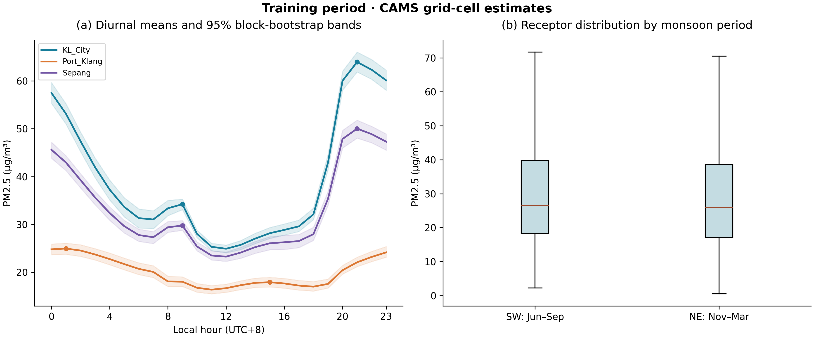
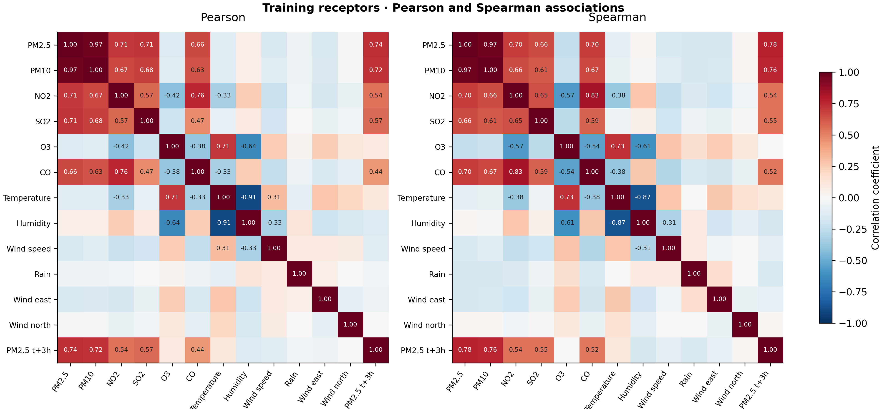
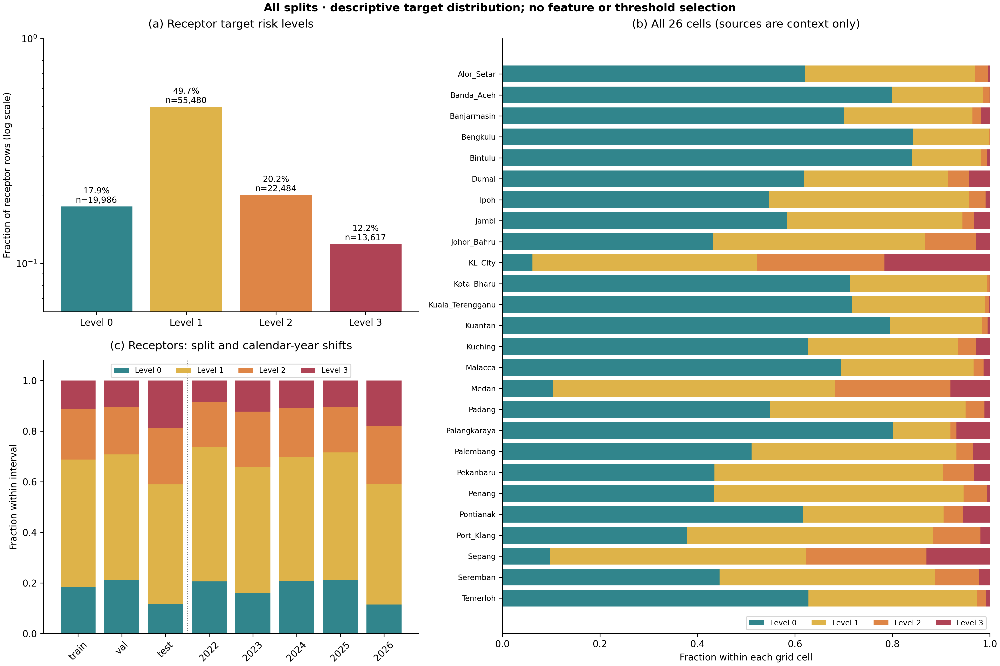
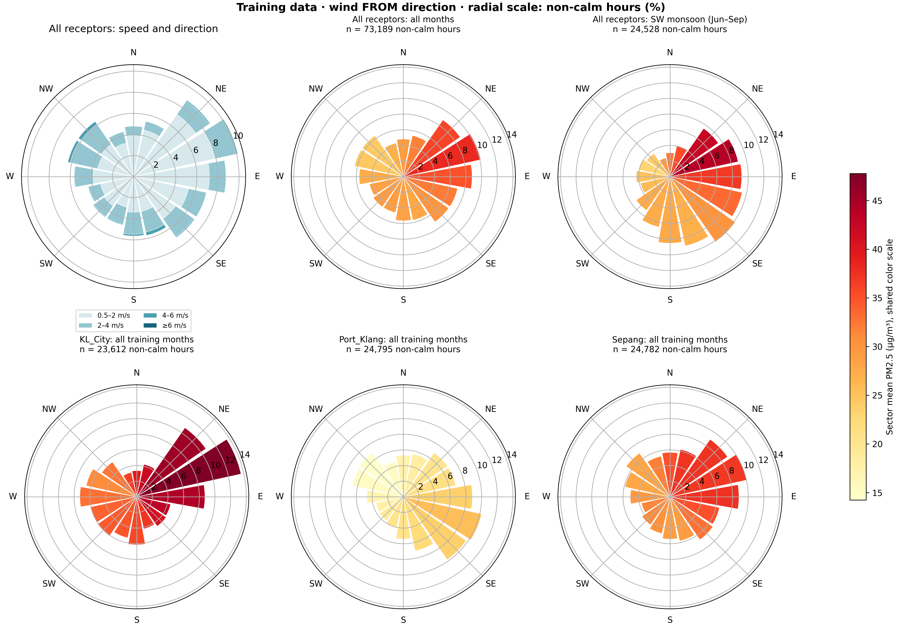
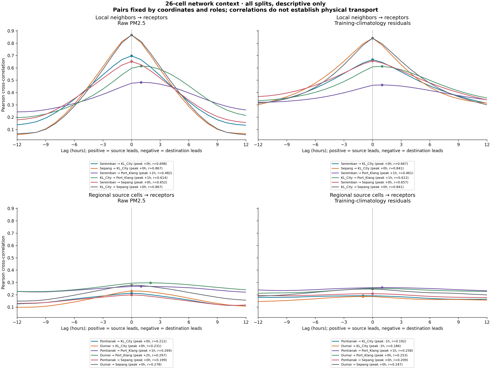

# Agent 2 exploratory analysis and spatiotemporal features

*Technical draft for verification and integration by the student authors.*

## 2.3 Exploratory Data Analysis

### Adopted 26 grid data scope

This analysis uses the existing `data/haze_panel_clean.parquet` at upstream revision `2cd57c5`. The input contains 966,677 rows and 35 columns, spanning 4 August 2022 to 31 October 2026 in Kuala Lumpur local time. Its SHA256 was verified against Agent 1's manifest. Agent 2 neither downloaded another dataset nor changed any upstream file. The four upstream Gate 0 checks pass under the repository's revised receptor-based rules. This does not constitute a new validation against ground observations.

The project group has formally adopted the 26 grid design. The current consolidated contract is `docs/technical_spec_26grid.md`, based on the existing registry, data dictionary, manifest and project decision. No separate newer specification document was present in the audited repository or its branches. Non-conflicting temporal feature definitions, figure filenames and the spatial baseline are inherited from v2.0. The adopted design, rather than the former eight-location proposal, defines this delivery's acceptance scope.

| Item | Current contract | Implemented scope |
|---|---|---|
| Spatial units | 26 registered grid sampling series | Actual IDs, roles, coordinates and series differences checked |
| Main prediction population | Three receptors | KL_City, Port_Klang and Sepang; 10 corridors and 13 sources provide context |
| Period | Existing cleaned panel | August 2022 to October 2026 |
| Input path | `data/haze_panel_clean.parquet` | Read-only current default; alternate inputs require explicit arguments |
| Diurnal and wind summaries | Training receptor population | Pooled and per-receptor views, with all-node wind statistics in JSON |
| Cross-correlation pairs | Geometry and role selected candidates | 12 fixed pairs from 75 directed candidates; no pollution ranking |
| Spatial kernel | Reproducible 15 km baseline | Retained with training-only distance, support and concentration diagnostics |

Historical candidate names and the original deduplication evidence are retained for provenance, but do not control current runtime pair selection. Coordinates are the existing valid sampling coordinates; the archive does not establish that they are the exact model grid centres. The 26-cell distribution supplies network context, while receptor rows define the primary modelling population.

An additional check aligns clean training PM2.5 values by exact timestamp for every pair of the 26 retained cells. None of the 325 pairs is exactly identical on its overlapping training hours. The largest absolute Pearson correlation is 0.9086 for Alor_Setar and Penang, using 26,034 paired hours; no pair reaches the disclosed diagnostic threshold of 0.95. These results do not establish statistical independence or independent model errors. The historical discovery file documents duplicate candidate locations before deduplication, whereas this new check applies to the delivered panel.

Air quality values are CAMS model estimates obtained through Open-Meteo, not measurements at monitoring stations. Open-Meteo documents the global product at approximately 45 km spatial resolution and three-hour native temporal resolution, although the supplied API table is hourly. An hourly table alone cannot establish independent hourly information. The weather acquisition code does not select a specific `models` value, and the repository does not retain response-level model metadata. Therefore, the weather archive cannot be identified conclusively as pure ERA5 or assigned a single verified resolution. Open-Meteo's default archive combines products. Both the archive and derived features are retrospective; operational availability at issue time has not been demonstrated. [Open-Meteo air quality documentation](https://open-meteo.com/en/docs/air-quality-api), [historical weather documentation](https://open-meteo.com/en/docs/historical-weather-api).

Figures 1, 2 and 4 use training receptor rows after excluding rows marked as interpolated or still missing. Figure 2 also requires an exact, quality-checked target at t+3h within the same split. Figures 3 and 5 describe all splits, as permitted for descriptive analysis; they were not used to choose features, bandwidths or thresholds. No prediction model was fitted in this stage. All numerical results below are recorded in `models/metrics_stage2_eda.json` and `models/metrics_stage2_features.json`.

### Figure 1 Diurnal and monsoon-period distributions

**Observation.** KL_City and Sepang have local maxima at 09:00 and 21:00, whereas Port_Klang has local maxima at 01:00 and 15:00. The southwest-monsoon receptor median is 26.6 µg/m³, compared with 26.0 µg/m³ during the northeast-monsoon months. Their interquartile ranges are 18.3–39.7 and 17.0–38.5 µg/m³, respectively. The seasonal contrast is small in this training sample. The plot does not impose an early-morning and evening pattern on every cell.

**Physical interpretation.** Repeated emissions, boundary-layer evolution and the atmospheric model's temporal structure could contribute to the diurnal pattern. The different Port_Klang phase argues against treating one receptor curve as a universal local cycle. Seasonal boxplots pool cells, years and hours, so their difference does not isolate a monsoon effect or establish a biomass-burning contribution.

**Implication for modelling.** Hour and month are encoded cyclically, and short historical changes remain separate from calendar features. The shaded intervals are pointwise percentile intervals from a circular moving-block bootstrap of dates: seven-day blocks, 400 replicates and seed 42. Each resampled date retains its hourly profile. These bands account for short-range dependence within the chosen block length, but do not quantify model bias, spatial representativeness or simultaneous coverage over the whole curve.

### Figure 2 Associations with the three-hour target

**Observation.** Current PM2.5 is associated with the future target in both Pearson correlation (0.737) and Spearman correlation (0.779). PM10 has corresponding coefficients of 0.721 and 0.760. Wind speed has weaker pooled associations, at −0.107 and −0.091. Only cells with an absolute coefficient above 0.3 are annotated; this is a display rule rather than a selection threshold.

**Physical interpretation.** Concentration persistence and shared model structure can produce strong pollutant associations. The PM2.5–PM10 association also reflects related particle quantities. Weak marginal wind correlations do not exclude conditional relationships with direction, humidity or cell geometry. The matrix pools receptor cells and contains repeated time-series samples; its coefficients are descriptive associations without independent-sample significance claims.

**Implication for modelling.** Lagged pollutant values provide a persistence-oriented reference against which spatial features should be tested. Wind direction is represented by vector components rather than correlated as a linear degree variable. Agent 3 should assess incremental predictive value within time-ordered training and validation folds, rather than retain only features with large marginal correlations.

### Figure 3 Ordered risk-level distribution

**Observation.** Across receptor rows, the four future-level counts are 19,986, 55,480, 22,484 and 13,617. Level 1 accounts for approximately half of the receptor samples. Level 3 represents 12.2% overall and is not globally scarce in this panel, although its local support differs across cells. Port_Klang has Level 2 and Level 3 proportions of 9.73% and 1.94%. The new time panels show Level 3 proportions of 11.13%, 10.59% and 18.85% in train, validation and test. Its calendar-year share increases from 10.37% in 2025 to 17.92% in the available part of 2026. The endpoints of 2022 and 2026 cover partial years, so these bars are not balanced annual comparisons.

**Physical interpretation.** The differences describe model grid-cell estimates and cannot establish differences in measured personal exposure. Including low-concentration source and corridor cells in a pooled training population would change the class prior relevant to KL receptors. The four categories are project experimental risk levels with concentration thresholds of 15, 35 and 55 µg/m³. They are not official hourly AQI health standards.

**Implication for modelling.** Main model comparisons should continue to train, validate and evaluate on receptor rows. The all-node stacked panel provides context without expanding the main training population. Level 2 is 20.05%, 18.61% and 22.18% across the three splits, while the stronger Level 3 change motivates reporting class-specific support. These descriptive held-out distributions are not used to choose thresholds or features. Downstream reports should disclose class counts after the eligibility filter. Figure 3 describes the original target table, not only rows accepted for fitting.

### Figure 4 Wind direction, speed and concentration

**Observation.** The training wind summary contains 73,189 non-calm receptor rows. The sector centred on 67.5° has the highest sector mean, 38.11 µg/m³, whereas the 225° southwest sector has a mean of 29.36 µg/m³. The six-panel figure retains wind-speed and pollution summaries and adds a southwest-monsoon calendar slice and three receptor views. The calendar slice contains 24,528 non-calm receptor rows. Within it, southwest-from winds from 202.5° inclusive to 247.5° exclusive account for 10.15% of rows, with mean PM2.5 of 27.28 µg/m³. Under those winds, the corresponding receptor means are 33.04 for KL_City, 19.17 for Port_Klang and 27.41 for Sepang. All 26 nodes have separate all-month and southwest-monsoon summaries in the JSON.

**Physical interpretation.** Southwest-monsoon months and southwest-from winds describe different conditions: a calendar subset need not contain only southwest winds. Their separation avoids attributing a calendar contrast to one direction. A directional association may reflect season, local emissions, receptor composition or parent-model circulation, and cannot identify a geographic emission source. Calm hours are excluded because their directions are unreliable. Direction denotes where wind comes from, with north at zero and clockwise angles; the feature vector describes air movement in the opposite direction.

**Implication for modelling.** The wind-vector and geometric aggregation features are implemented as hypotheses to test. Their value should be determined by validation ablations and quality-sensitive analyses, without assuming that southwest flow must increase pollution. Regional fire attribution would require additional evidence beyond this single-source project.

### Figure 5 Geometry selected local and regional lead lag associations

**Observation.** Positive lag k is corr[source(t−k), destination(t)], so positive peaks indicate source lead. Candidate pairs are fixed before reading pollution: each receptor receives its nearest other receptor and nearest corridor within 150 km, plus the nearest source in each source region. All 75 directed candidates and the 12 selected pairs are recorded. Local raw peaks range from 0.482 to 0.867 and occur at 0 or +1 hour. The KL_City-to-Port_Klang peak is +1 hour with r=0.614, so this direction indicates inland lead rather than coastal lead. Regional raw peaks range from 0.199 to 0.297, with lags from 0 to +2 hours. Dumai-to-Port_Klang changes from +2 hours and r=0.297 before adjustment to 0 hours and r=0.253 after adjustment. The training-climatology residuals therefore do not support one uniform regional lead time.

**Physical interpretation.** Removing a training climatology reduces shared calendar structure but does not remove all confounding or autocorrelation. Adjacent cells may share atmospheric forcing and model dynamics. A broad correlation maximum, including one at a negative lag, is insufficient evidence for transport direction, causal transmission or a stable travel time.

**Implication for modelling.** The fixed one- and two-hour spatial features remain unchanged; their lags and distance bandwidth are not selected from the all-split curves. Geometry-only selection includes weak regional associations instead of hiding them or searching for favourable peaks. No transport-speed estimate is inferred. Cross-correlations use exact timestamp joins over −12h to +12h; gaps remain missing rather than compressing time. Stability across years and independent pollution evidence remains to be investigated.

## 2.4.1 Temporal Lag, Rolling & Monsoon Upwind Advection Features

### Temporal information available at issue time

The output `data/feat_spatiotemporal.parquet` preserves all input rows, their order, original column names, values and dtypes, and adds 56 columns. Its resulting shape is 966,677 by 91. New continuous columns use float32 precision; original columns retain their existing precision. No imputation, scaling, feature selection or learned model is fitted by Agent 2.

PM2.5, PM10, NO2 and relative humidity each receive lags at 1, 2, 3, 6, 12 and 24 hours. PM2.5 also receives rolling mean, sample standard deviation (ddof=1) and range over 3, 6 and 12 hours. The rolling family applies to PM2.5; the other three variables receive the specified lag family. The three-hour change is x(t)−x(t−3), and the six-hour trend is an ordinary least-squares slope on equally spaced hours, expressed in µg/m³ per hour.

Rolling windows end at t and include the current value, under the explicit assumption that the value at issue time has become available. A window requires all its hourly samples. Calculations operate separately within each node and split, on an internal complete hourly index. Missing hours are never filled, and the original table is not expanded. Consequently, a missing hour produces an unavailable exact lag or incomplete rolling window, rather than a misleading previous-row value. Validation and test histories restart at their split boundaries, following v2.0's strict boundary rule.

Hour, day of week and month receive sine/cosine encodings with periods of 24, 7 and 12. Month is zero-based before encoding. Time calculations use Asia/Kuala_Lumpur; timezone-aware inputs are converted to that zone, while timezone-naive input is interpreted according to the upstream local-time contract.

### Wind vectors and directional spatial aggregation

Wind speed is read from `wind_speed_ms`, cross-checked against `wind_speed_kmh / 3.6` when both exist. The km/h value is converted only when a named m/s column is absent. A legacy `wind_speed_10m` field requires an explicit unit argument, avoiding a silent double conversion. Meteorological wind-from direction θ produces eastward and northward components:

u = −s sin(θπ/180), v = −s cos(θπ/180).

Vectors are set to zero for calm speeds below 0.5 m/s or an existing calm-wind flag. The implementation computes great-circle distance D in kilometres and an east/north unit vector e at source j pointing toward destination i. Self-links and co-located points are excluded. The specified weight is:

w(j→i,t) = max[0, vector(j,t) · e(j→i)] exp[−D(j,i)²/(2σ²)], σ = 15 km.

Projection values at floating-point zero and weights at or below 10⁻¹² m/s are discarded before normalization. This numerical floor prevents a practically disconnected remote node from becoming the sole apparent neighbor. For k equal to one or two hours, both the source concentration and source wind are taken at exactly t−k, and the source must belong to the destination row's split. The weighted mean excludes unavailable source values from both numerator and denominator. A zero denominator produces NaN, not zero concentration or a fallback drawn from another period.

`spatial_pm25_gradient` is current destination PM2.5 minus the contemporaneous directional neighbor mean. This choice makes its time reference explicit; it is not current concentration minus a lagged neighbor value. Weight sums and contributing-neighbor counts accompany both lagged spatial means. They distinguish lack of spatial support from an actual low concentration.

The 15 km bandwidth is narrow relative to the expanded regional network. One-hour advection is available for 86.15% of KL_City rows, 72.87% of Port_Klang rows and 95.41% of Sepang rows. These are numerical support rates, not evidence of useful inter-island transport. Distant Sumatra and Borneo cells receive negligible weight at this scale, and the aggregation has no travel-time model. Any broader bandwidth or longer transport lag requires a separately reported validation experiment. No bandwidth search was conducted here.

The additional training-only diagnostic covers all 676,884 training rows. There are 325 coordinate pairs, no duplicate sampling coordinates, and no pair within the 15 km bandwidth. The nearest-neighbour distance across nodes has a minimum of 28.33 km and a median of 133.32 km. Zero usable directional weight occurs in 496,245 rows, or 73.31% of this whole-network training population. When support exists, the median largest normalized weight is 1.0 and the median effective neighbour count, defined as 1/Σp² for normalized weights p, is also 1.0. Its mean is 1.114. This measures strong single-source concentration rather than broad regional mixing. Training one-hour coverage for the three receptors is 85.09%, 71.60% and 94.77%, respectively; these training rates differ from the preceding all-split rates. The diagnostics share production weight calculations and cannot change the fixed kernel or use held-out labels.

### Availability flags and downstream use

Upstream linear interpolation uses future endpoints and was performed before splitting. Agent 2 conservatively treats rows flagged `qc_interpolated` or `is_missing` as unavailable for new concentration histories and wind/spatial contributions. Original interpolated values and upstream fitted baselines remain unchanged. The eligibility flag alone cannot make every retained upstream column safe: downstream code should use the explicit `model_feature_columns` list in the feature audit rather than all numeric columns. That list excludes labels, diagnostic eligibility flags, raw wind direction and upstream baseline/anomaly columns.

An additional exact t+3h audit checks target alignment, class thresholds, source quality and split boundaries. It adds flags rather than changing or deleting labels. Eligibility requires clean current input, complete requested temporal histories and a verified future target within the same split. The accepted receptor counts are 77,753 training, 16,656 validation and 16,647 test rows. This conservative policy also rejects endpoint labels whose future row cannot be verified from the supplied cleaned table. Target-audit flags depend on future label availability and must never be used as predictor features or as conditions for issuing a live forecast.

Missing spatial features are expected. A downstream estimator must handle them explicitly or fit an imputer only on its training fold. Within-fold feature transforms, climatologies and selection must be rebuilt for each time-series validation or held-out-node experiment. A label horizon also requires purging training examples whose target time reaches a later validation fold. Agent 2's top-level split flags do not implement future CV folds or establish an absence of all upstream leakage.

### Verification and limitations

The implementation is checked against synthetic examples with known slopes, distances, wind signs, gaps and time delays. Tests perturb future and held-out values to verify issue-time feature invariance, check exact unit conversion, isolate node/split boundaries, and distinguish an absent neighbor from a clean concentration. The original Agent 1 checker is also run without rewriting its manifest. Verification results and environment versions are recorded separately in `models/metrics_stage2_verification.json`.

These checks establish the documented transformations on the available panel. They do not validate the parent atmospheric models, the accuracy of the original retrieval, the independent nature of hourly values or operational forecast availability. The upstream flags for PM2.5 greater than PM10 and censored concentrations are preserved for later sensitivity analysis. Claims in earlier repository prose that particular high-value periods are confirmed real haze events have not been independently verified here. No model improvement, causal transport effect, calibrated health benefit or measured exposure reduction is claimed.

### Sources and reproducible evidence

- Uploaded specification: *HazeGuard-KL_技术规范_v2.0.docx*, SHA256 `e15c706d08d86ce6939938c55666d16b8d4c15aea7ebf479b12504921ee7bd04`.
- Current adopted scope: `docs/technical_spec_26grid.md`, consolidated from the project group's confirmed decision and the existing machine-readable registry and data contract. The older specification supplies only non-conflicting inherited definitions.
- Repository evidence: `src/config.py`, `src/01_data_pipeline.py`, `docs/node_discovery.json`, `data/manifest.json`, `models/gate0_report.json` and `docs/handover/01_data_and_baseline.md` at the stated upstream revision.
- [Open-Meteo Air Quality API](https://open-meteo.com/en/docs/air-quality-api), consulted 8 November 2026. Underlying CAMS data and Open-Meteo require attribution under their stated licences.
- [Open-Meteo Historical Weather API](https://open-meteo.com/en/docs/historical-weather-api), consulted 8 November 2026. This documents default model selection and the distinction between reanalysis and station observations.
