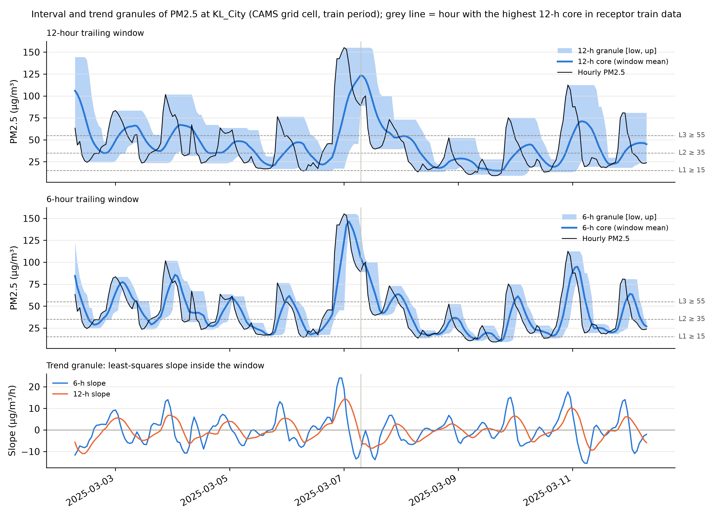
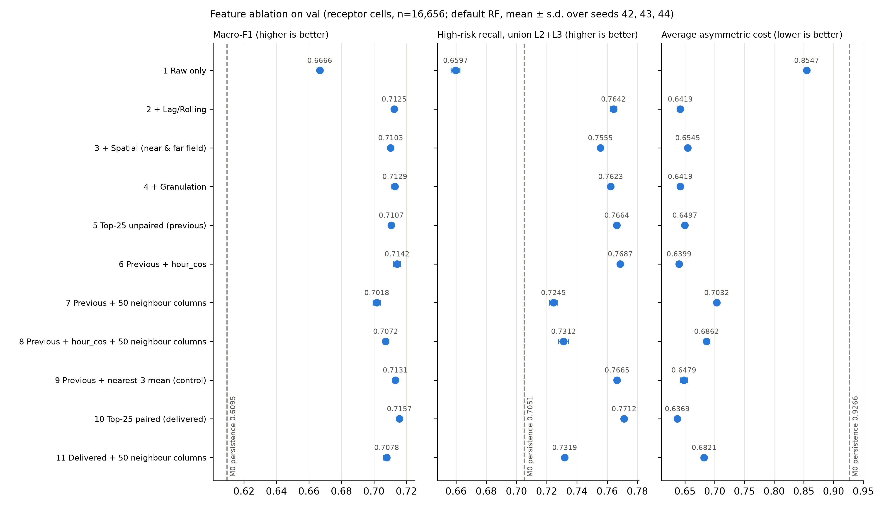

# Window granulation and feature selection

## 2.4.2 Window Granulation

At issue time t the model sees the hourly PM2.5 values of the last few hours. A single lag reports one past value. It does not say how high the recent level was, how much it varied, or whether it was rising, and a haze pulse is mainly a change of this kind. We therefore summarise each trailing window with an interval granule (lower bound, core, upper bound) and a trend granule (least-squares slope), using windows of 6 and 12 hours. An earlier plan with fuzzy C-means prototypes was dropped because it falls outside the course scope and overlaps with rolling statistics.

For a grid cell and issue time t, with hourly PM2.5 x in µg/m³, the trailing window is

$$\mathbf{x}_W(t) = \left(x_{t-W+1}, \dots, x_t\right), \qquad W \in \{6, 12\},$$

and the five granule values are

$$\text{low} = \min_k x_k, \quad \text{core} = \frac{1}{W}\sum_{k=1}^{W} x_k, \quad \text{up} = \max_k x_k, \quad \text{width} = \text{up} - \text{low},$$

$$\text{slope} = \frac{\sum_{k=1}^{W} (k-\bar{k})\, x_k}{\sum_{k=1}^{W} (k-\bar{k})^2}, \qquad \bar{k} = \frac{W+1}{2}.$$

This gives ten columns named `gran_{low,core,up,width,slope}_{6,12}h`. The slope is in µg/m³ per hour and the others in µg/m³.

Each window uses hour t and earlier hours only. Windows are built per grid cell and split on a complete hourly grid, and hours flagged as interpolated or missing are left empty. A window with any empty hour gives missing values. This happens in 0.155% of panel rows for 6 hours and 0.27% for 12 hours, and in no eligible receptor row. The statistics have no fitted parameters, so nothing is estimated on the training split.

Five of the ten columns are identical, value by value, to stage 2 columns: the two cores equal `pm2_5_mean_6h` and `pm2_5_mean_12h`, the two widths equal `pm2_5_range_6h` and `pm2_5_range_12h`, and the 6-hour slope equals `pm2_5_slope_6h`. This confirms that both modules build windows the same way. Only the other five columns (`gran_low_6h`, `gran_up_6h`, `gran_low_12h`, `gran_up_12h`, `gran_slope_12h`) enter feature selection.

### Figure 6 Interval and trend granules during a haze pulse

The figure shows the KL_City grid cell for five days on either side of 07:00 on 7 March 2025, the hour with the highest 12-hour core among eligible receptor training rows. When the pulse enters the window, the 12-hour band widens at once, since the upper bound jumps while the lower bound still holds the earlier clean hours. It stays wide for about half a day after the peak, until the peak hour leaves the window. The 6-hour band and slope react faster: the 6-hour slope peaks during the build-up and turns negative soon after the peak.

## 2.5 Feature Selection and Ablation

### Candidates and fitting rows

The candidates are the 63 columns of the stage 2 whitelist `model_feature_columns` (12 original variables and 51 stage 2 predictors) plus the five new granulation columns, 68 in total. Climatological anomalies, audit flags, weight diagnostics, identifiers and targets are excluded. Selection uses only the 77,753 eligible receptor rows of the training split, sorted by time.

The near-field upwind features are missing when no valid upwind neighbour lies within 150 km. Among eligible receptor rows this affects 9.76% of training, 9.74% of validation and 4.52% of test rows. We filled these cells with fixed rules before selection (Table 1). The rules have no parameters and do not treat a missing value as zero concentration.

**Table 1.** Filling rules for missing spatial values.

| Column | Filled with | Rows filled (train / val / test) |
|---|---|---|
| `upwind_pm25_advection_{1,2,3}h` | the cell's own `pm2_5_lag_{1,2,3}` | 7,584 to 7,586 / 1,623 / 753 |
| `spatial_pm25_gradient` | 0 | 7,587 / 1,623 / 753 |
| `far_source_pm25_mean_48h` | `far_source_pm25_mean_24h` at the same hour | 70 / 72 / 72 |

### Selection procedure

Three filters were applied to the training rows:

1. mutual information with the four-level target, keeping the top 30;
2. a quasi-constant filter (no column removed), then greedy Spearman pruning at |ρ| > 0.92, which kept 47 columns;
3. permutation importance on an internal holdout (the last 20% of training time, from 19 December 2024, 15,606 rows), with a default random forest fitted on the 62,138 earlier rows (leaving a three-hour gap) and scored by macro-F1, keeping the top 30.

Their union of 64 columns was reduced to 25 by recursive feature elimination with a default random forest. The union removed only four candidates, so the elimination step did most of the work. A first run kept `hour_sin` without `hour_cos`. A sine alone cannot tell apart hours with the same sine value, such as 03:00 and 09:00, so we treated each sin/cos pair (hour, day of week, month) as one unit. Elimination removes the weakest unit, with a pair scored by the sum of its two importances, and stops at exactly 25 columns. The final Top-25 (listed in `models/selected_features.json`) contains both hour terms, seven original variables, eleven other stage 2 temporal features, two spatial features and three granulation features. Compared with the first run, `hour_cos` replaced `gran_low_12h`. None of the advection columns `upwind_pm25_advection_1h`, `_2h` or `_3h` was selected.

### Ablation

We trained a default random forest with seeds 42, 43 and 44 and evaluated on the validation split (16,656 eligible receptor rows, 4,842 high risk). Sets 1 to 4 add one feature family at a time. Sets 5 to 8 separate two factors on top of the first-run Top-25: the missing `hour_cos` and raw neighbour values. For the raw neighbour values, each receptor takes all 25 other grid cells, ordered by distance, and for each cell its PM2.5 at hour t and its 3-hour change. This gives 50 columns with no averaging and no upwind weights, so any effect can be attributed to neighbour concentration itself. Hours flagged as interpolated or missing are left missing for the forest to handle. Set 9 is a control that replaces the 50 columns with the mean of the three nearest cells, 28 to 68 km away. Set 10 is the delivered Top-25, and set 11 adds the 50 neighbour columns to it. Metrics come from `src/utils_metrics.py`. High-risk recall is the share of true Level 2 or 3 hours predicted as Level 2 or 3. M0 predicts the current level.

**Table 2.** Feature ablation on the validation split (mean ± standard deviation over three seeds).

| Feature set | Columns | Macro-F1 | High-risk recall | MAOE | Avg. cost |
|---|---:|---|---|---|---|
| M0 persistence | n/a | 0.6095 | 0.7051 | 0.3811 | 0.9266 |
| 1. Original variables | 12 | 0.6666 ± 0.0012 | 0.6597 ± 0.0029 | 0.3053 | 0.8547 |
| 2. + Lag and rolling | 53 | 0.7125 ± 0.0013 | 0.7642 ± 0.0022 | 0.2566 | 0.6419 |
| 3. + Spatial | 63 | 0.7103 ± 0.0006 | 0.7555 ± 0.0010 | 0.2579 | 0.6545 |
| 4. + Granulation | 68 | 0.7129 ± 0.0018 | 0.7623 ± 0.0006 | 0.2561 | 0.6419 |
| 5. First-run Top-25 | 25 | 0.7107 ± 0.0013 | 0.7664 ± 0.0019 | 0.2597 | 0.6497 |
| 6. Set 5 + `hour_cos` | 26 | 0.7142 ± 0.0021 | 0.7687 ± 0.0013 | 0.2557 | 0.6399 |
| 7. Set 5 + 50 neighbour columns | 75 | 0.7018 ± 0.0022 | 0.7245 ± 0.0025 | 0.2656 | 0.7032 |
| 8. Set 5 + `hour_cos` + 50 neighbour columns | 76 | 0.7072 ± 0.0015 | 0.7312 ± 0.0032 | 0.2602 | 0.6862 |
| 9. Set 5 + nearest-3 mean (control) | 26 | 0.7131 ± 0.0011 | 0.7665 ± 0.0019 | 0.2565 | 0.6479 |
| 10. Paired Top-25 (delivered) | 25 | 0.7157 ± 0.0010 | 0.7712 ± 0.0008 | 0.2546 | 0.6369 |
| 11. Set 10 + 50 neighbour columns | 75 | 0.7078 ± 0.0018 | 0.7319 ± 0.0009 | 0.2593 | 0.6821 |

### Figure 7 Feature ablation on the validation split

Dots are means over three seeds, bars one standard deviation, and the dashed line is M0.

### Findings

**Lags and rolling statistics give almost all of the gain.** They raise macro-F1 by 0.046 (0.6666 to 0.7125) and high-risk recall by 0.10 (0.6597 to 0.7642). With the original variables alone, high-risk recall stays below M0 (0.6597 against 0.7051).

**The upwind spatial features did not help.** Adding them lowers macro-F1 from 0.7125 to 0.7103 and high-risk recall from 0.7642 to 0.7555, drops larger than the seed standard deviations. This result concerns the weighted advection features from stage 2. Raw neighbour concentration is a different feature and is tested separately below. No advection column was selected. Two facts explain this. The forecast horizon is three hours, and the Sumatran and Bornean source cells lie outside the 150 km near-field radius, so they only describe the regional background. And in about one row in ten the filled advection columns simply repeat the cell's own lags. The value of spatial information is better judged in the cross-cell generalisation study.

**Granulation adds little.** Set 4 is only 0.0004 above set 2 in macro-F1 (0.7129 against 0.7125) with the same average cost. Three granulation columns were still selected, but most of their information is already in the rolling features.

**The half-encoded hour was a real defect.** Adding `hour_cos` to the first-run Top-25 improves all three metrics: macro-F1 from 0.7107 to 0.7142, high-risk recall from 0.7664 to 0.7687 and average cost from 0.6497 to 0.6399.

**Raw neighbour columns did not help this model.** Adding the 50 columns lowers macro-F1 from 0.7107 to 0.7018, high-risk recall from 0.7664 to 0.7245 and raises the average cost from 0.6497 to 0.7032. The same happens on the delivered set (set 11 against set 10). We checked that each column holds the right cell's value at the right hour, and a layout with one fixed column per cell (recorded in `models/metrics_stage3.json`) also performed worse. A possible reason is that the default forest samples only the square root of the number of features at each split, so with 75 columns the receptor's own strong features are offered less often, while most of the 50 columns describe cells hundreds of kilometres away. Another team member found a gain from the same kind of features with a different model, so this result should be read as specific to the default forest used here. The control with the nearest-3 mean changes little (macro-F1 +0.0024, recall almost unchanged).

**The paired Top-25 is the best set.** With 25 of 68 candidates it gives the highest macro-F1 (0.7157), the highest high-risk recall (0.7712) and the lowest average cost (0.6369) of all eleven sets, so the neighbour columns were not added to the final table.

**Limitations.** The standard deviations only reflect the forest seed, so differences below about 0.01 should not be read as firm rankings. Because the Top-25 was chosen on the whole training split, later cross-validation inside that split will be slightly optimistic. No test data were used here.

**Sources.** `models/selected_features.json` (selection and filling), `models/metrics_stage3.json` (ablation, per-seed values, M0 and the neighbourhood definition), `models/metrics_stage2_features.json` (missing rates, 150 km radius); code in `src/03_granulation_features.py` and `src/03_feature_selection.py`.
