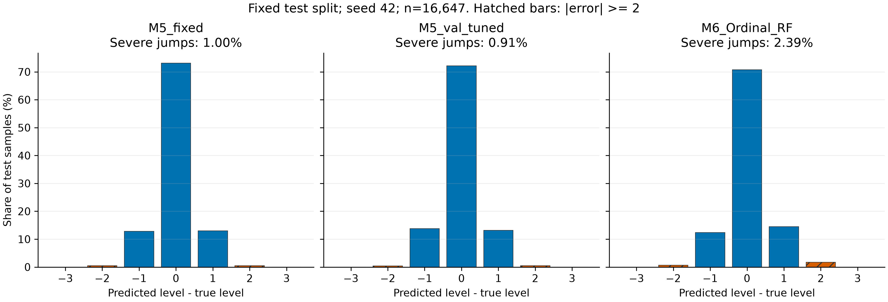
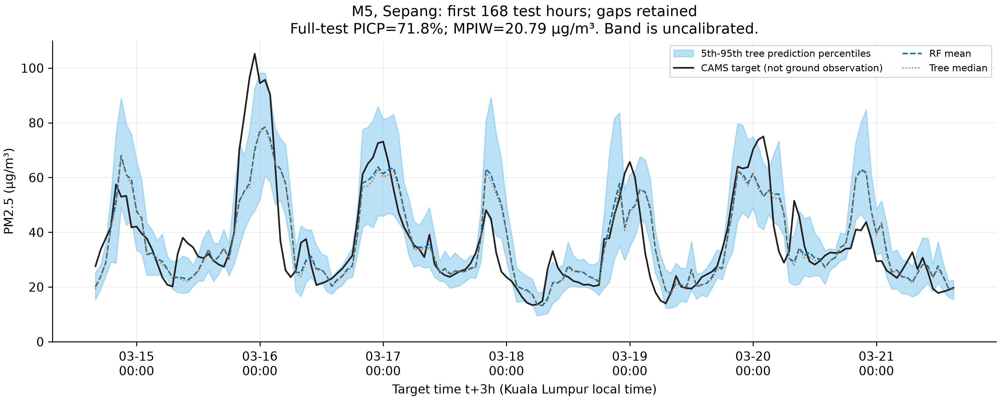

# 第 5 部分：实验事实与自主撰写提纲

本文件用于理解实验、核对数字及组织自己的报告，不是直接提交的英文报告正文。
数据来源：`models/metrics_stage5.json`；前序模型对照来自 04 分支的 `models/metrics_stage4.json`。

## 1. 问题与方法

- 问题：相同 25 个特征下，连续浓度回归再分档与累积有序分类各有什么得失？
- M5：RF 回归 t+3h 浓度，按 [15,35,55] 切档；另列仅用 val 选择的切点对照。
- M6：3 个二分类 RF 学习 P(Y>0)、P(Y>1)、P(Y>2)，使用 balanced_subsample。
- 修正：q* = cumulative minimum(q)，p = [1-q0*,q0*-q1*,q1*-q2*,q2*]，归一化、argmax。
- 概率单调只是输出一致性，不等于保证跨级错误减少或概率已经校准。

方法出处：[Frank & Hall, A Simple Approach to Ordinal Classification](https://ml.cms.waikato.ac.nz/publications/2001/ordinal_tech_report.pdf)。

## 2. 实验设置

- 受体节点：KL_City、Port_Klang、Sepang；数据是 CAMS 模式产品，不是地面监测记录。
- 行数：train 77,753；val 16,656；test 16,647。
- 5 折按唯一时间戳切分，所有节点同刻一起划分；训练行的 t+3h 必须早于折验证开始。
- 特征选择沿用上游固定 Top-25；上游用了完整 train，因此内部 CV 不是嵌套验证。
- 候选以 val Macro-F1 为主选定。所有超参数、阈值和种子方案冻结后再预测 test。
- 验证集报种子 42、43、44 的均值 ± 样本标准差；test 仅报预先指定的种子 42。
- 标准差描述随机森林种子波动，不是置信区间，也不是统计显著性检验。

时间划分参考：[scikit-learn TimeSeriesSplit](https://scikit-learn.org/stable/modules/generated/sklearn.model_selection.TimeSeriesSplit.html)。

选定结构与预测切点：

```json
{
  "selected_regressor_params": {
    "n_estimators": 100,
    "max_depth": 14,
    "min_samples_leaf": 10,
    "max_features": 0.5
  },
  "selected_ordinal_params": {
    "n_estimators": 100,
    "max_depth": 14,
    "min_samples_leaf": 10,
    "max_features": 0.5
  },
  "ordinal_class_weight": "balanced_subsample",
  "m5_fixed_thresholds": [
    15.0,
    35.0,
    55.0
  ],
  "m5_val_tuned_thresholds": [
    17.0,
    33.0,
    55.0
  ]
}
```

M5 搜索切点只改预测决策，真实类别始终由固定 [15,35,55] 定义。

## 3. 验证集稳定性

| 模型 | Macro_F1 | Balanced_Accuracy | High_Risk_Recall | MAOE | Severe_Jumping_Error_Rate | Avg_Asymmetric_Cost |
|---|---|---|---|---|---|---|
| M5_fixed | 0.7152 ± 0.0007 | 0.6977 ± 0.0015 | 0.8094 ± 0.0020 | 0.2566 ± 0.0003 | 0.0066 ± 0.0003 | 0.5936 ± 0.0029 |
| M5_val_tuned | 0.7195 ± 0.0017 | 0.7234 ± 0.0021 | 0.8600 ± 0.0011 | 0.2644 ± 0.0017 | 0.0061 ± 0.0003 | 0.5871 ± 0.0038 |
| M6_Ordinal_RF | 0.6893 ± 0.0007 | 0.7334 ± 0.0008 | 0.8439 ± 0.0010 | 0.3028 ± 0.0010 | 0.0218 ± 0.0003 | 0.5879 ± 0.0021 |

## 4. 最终测试集：统一行数，种子 42

| 模型 | Macro_F1 | Balanced_Accuracy | High_Risk_Recall | MAOE | Severe_Jumping_Error_Rate | Avg_Asymmetric_Cost |
|---|---|---|---|---|---|---|
| M2_Nominal_RF | 0.7014 | 0.6824 | 0.8094 | 0.2813 | 0.0138 | 0.7700 |
| M3_Balanced_RF | 0.7018 | 0.7206 | 0.8873 | 0.3003 | 0.0146 | 0.6512 |
| M4_Boosting | 0.7005 | 0.6871 | 0.8332 | 0.2858 | 0.0135 | 0.7250 |
| M5_fixed | 0.7000 | 0.6793 | 0.8413 | 0.2787 | 0.0100 | 0.7242 |
| M5_val_tuned | 0.7078 | 0.7117 | 0.8788 | 0.2873 | 0.0091 | 0.7083 |
| M6_Ordinal_RF | 0.6839 | 0.7139 | 0.8642 | 0.3169 | 0.0239 | 0.6616 |

每个模型 n=16,647，真实高危 n=6848。
Macro-F1、Balanced Accuracy、高危召回越高越好；MAOE、跨两级误差、平均代价越低越好。
高危召回使用集合口径：真实为 L2/L3，预测也属于 L2/L3 即识别到高危。
本实验没有重新训练 M2～M4；这些是前序交付值，且其内部 CV 没有本模块的 3h 清除。

## 5. 单调修正与区间证据

| 切分 | 修正前违反样本 | 违反率 | 修正后违反样本 | PICP | MPIW (µg/m³) |
|---|---:|---:|---:|---:|---:|
| val | 580 | 3.48% | 0 | 0.7180 | 16.4788 |
| test | 883 | 5.30% | 0 | 0.7183 | 20.7877 |

区间来自 M5 各棵树浓度预测的 5/50/95 百分位，未经覆盖率校准，不是分位数随机森林。
PICP = mean(lower <= target <= upper)；MPIW = mean(upper-lower)。
“取 5%～95% 分位”描述树之间的分散范围，不能直接写成“真实未来浓度有 90% 概率在内”。



图：完整 test，种子 42。误差 = 预测等级 - 真实等级；负数代表低报，斜线柱表示跨两级及以上。



图：预先固定 Sepang 最早 168 个测试小时，横轴为目标时刻 t+3h；缺小时不连线。

## 6. 验收门槛的实际结果

- M5_fixed：高危召回门槛 未通过；MAOE 门槛 通过；两者同时满足：否。
- M5_val_tuned：高危召回门槛 通过；MAOE 门槛 通过；两者同时满足：是。
- M6_Ordinal_RF：高危召回门槛 未通过；MAOE 门槛 未通过；两者同时满足：否。

注意：规范给出的既有 M3 val 均值 0.8744/0.2822 已满足两道门槛，不能宣称此门槛从未被达到。

## 7. 自己写报告时要回答

1. 用一行自己的话解释：为什么先预测连续浓度再分档也能保留等级次序？
2. 对照两张表，分别比较 M5/M6 的高危召回、平均等级误差、跨级误判；不要只挑一个指标。
3. 阈值校准相对固定切点改变了哪些指标？验证集收益在 test 上是否保留？
4. M6 三个二分类器使用了各自的类权重，这与“只改变有序分解”有何不同？
5. 单调违反率能证明什么，不能证明什么？修正没有比较校准性或统计显著性。
6. 用实际 PICP 讨论树间区间的覆盖不足或过宽，避免把它当作保证。
7. 数据源、固定 Top-25、有限搜索、仅三颗种子、单次历史留出分别限制了哪些结论？

## 8. 可追溯与复核

- `metrics_stage5.json`：所有数字及输入、代码和模型摘要。
- `stage5_selection.json`：test 预测前已冻结的决策。
- `stage5_predictions.npz`：已保存预测与原始累积概率。
- `python tools/verify_stage5.py`：从保存预测复核，不再次预测 test。
- 只对随机种子报样本标准差；未做显著性检验，因此不写“显著优于”。
