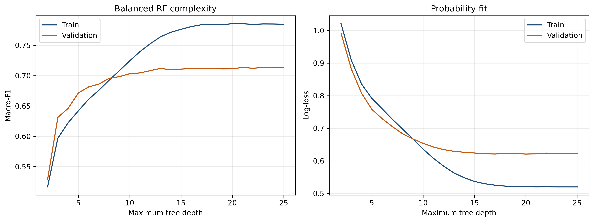
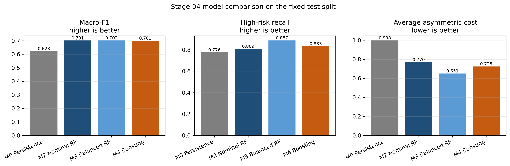
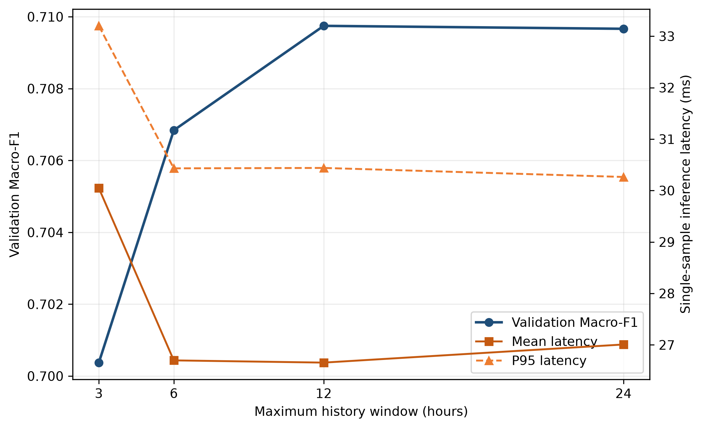

# 2.6 Classification Models M2, M3 and M4

## 2.6.1 Evaluation protocol

The three classifiers were trained on the same receptor-only population and the same 25 selected features. The eligible samples comprise 77,753 training rows, 16,656 validation rows and 16,647 test rows from KL_City, Port_Klang and Sepang. Rows were ordered by timestamp and station before fitting. Five time-series folds were formed from unique training timestamps, so observations from different receptors at the same hour stayed in the same fold.

M2 is a nominal random forest with no class weighting. M3 keeps the same forest structure and changes only `class_weight` to `balanced_subsample`. Both fitted models contain 100 trees, use a maximum depth of 14, require 20 samples per leaf and consider half of the input features at each split. M4 is a `HistGradientBoostingClassifier` with a learning rate of 0.06, 400 iterations, 31 maximum leaf nodes and 20 samples per leaf. Early stopping was disabled. This prevents an additional internal validation split from entering the fitted boosting model.

The random-forest search evaluated 12 configurations. The boosting search covered all 24 combinations in its registered grid. Validation Macro-F1 was the primary selection measure. RF candidates also had to use a bounded depth because the corresponding M2 and M3 files must each remain below 20 MiB while sharing all structural parameters. After selection, seeds 42, 43 and 44 were fitted on train and evaluated on validation. The final seed-42 models were then evaluated once on test. The saved record reports `test_evaluation_count=1`.

## 2.6.2 Validation results

Table 1 reports the mean and sample standard deviation across the three validation runs. M4 had the highest validation Macro-F1 at 0.7236. It also produced the lowest MAOE and severe-jump rate. M3 gave the strongest high-risk recall and the lowest asymmetric cost, although its Macro-F1 was lower than those of M2 and M4.

| Model | Macro-F1 | Balanced accuracy | High-risk recall | MAOE | Severe jump rate | Average cost |
|---|---:|---:|---:|---:|---:|---:|
| M2 Nominal RF | 0.7131 ± 0.0011 | 0.6949 ± 0.0011 | 0.7644 ± 0.0021 | 0.2575 ± 0.0007 | 0.0083 ± 0.0001 | 0.6465 ± 0.0026 |
| M3 Balanced RF | 0.7112 ± 0.0016 | 0.7369 ± 0.0019 | 0.8744 ± 0.0020 | 0.2822 ± 0.0012 | 0.0120 ± 0.0002 | 0.5642 ± 0.0022 |
| M4 Boosting | **0.7236 ± 0.0000** | 0.7108 ± 0.0000 | 0.7895 ± 0.0000 | **0.2490 ± 0.0000** | **0.0067 ± 0.0000** | 0.6038 ± 0.0000 |

The zero standard deviations for M4 have a mechanical explanation. This histogram boosting configuration has no stochastic subsampling, and changing `random_state` did not alter its fitted predictions. The result should not be read as evidence that M4 is invariant to a different validation period or receptor population.

The RF depth experiment gives additional context for the deployment choice. M3 validation Macro-F1 rose rapidly through shallow depths, reached 0.7097 at depth 14 and then entered a narrow plateau. The largest scanned value was 0.7136 at depth 21. Training Macro-F1 continued to rise while validation gains became small. The selected depth therefore retains most of the observed validation performance and keeps both forest artifacts within the repository limit.

## 2.6.3 Fixed test comparison

Table 2 gives the single fixed test evaluation. M0 persistence is included as a reference. All three fitted classifiers improved substantially on its Macro-F1 and average asymmetric cost.

| Model | Macro-F1 | Balanced accuracy | High-risk recall | MAOE | Severe jump rate | Average cost |
|---|---:|---:|---:|---:|---:|---:|
| M0 Persistence | 0.6231 | 0.6232 | 0.7757 | 0.3925 | 0.0374 | 0.9978 |
| M2 Nominal RF | 0.7014 | 0.6824 | 0.8094 | **0.2813** | 0.0138 | 0.7700 |
| M3 Balanced RF | **0.7018** | **0.7206** | **0.8873** | 0.3003 | 0.0146 | **0.6512** |
| M4 Boosting | 0.7005 | 0.6871 | 0.8332 | 0.2858 | **0.0135** | 0.7250 |

M3 is the preferred Stage 04 model under the project's high-risk and asymmetric-cost objective. Relative to M2, `class_weight='balanced_subsample'` increased high-risk recall from 0.8094 to 0.8873 and reduced average asymmetric cost from 0.7700 to 0.6512. These changes are operationally meaningful because missed Level 2 and Level 3 cases receive the larger penalties in the cost matrix.

The improvement is not free. M3's MAOE increased from 0.2813 to 0.3003, a difference of 0.0190. Class weighting moves the decision boundary toward higher predicted risk levels. That raises recall for high-risk cases, but it also creates more upward errors among lower-risk samples. M2 therefore retains the smaller ordinal error, while M3 accepts more over-reporting in exchange for fewer high-risk misses.

M4 illustrates why validation and test must retain separate roles. It was the strongest model on validation, where its Macro-F1 reached 0.7236. On test, its Macro-F1 fell to 0.7005, slightly below M3 at 0.7018. Its high-risk recall was 0.8332, also below M3's 0.8873. M4 still had a lower MAOE and severe-jump rate than M3, so the test result does not make boosting uniformly worse. It changes the ranking for the stated risk objective.

## 2.6.4 Selection discipline and sensitivity

The reversal between validation and test rankings is a useful warning. Selecting a model after inspecting test would convert the final evaluation split into another tuning set and make the reported estimate optimistic. In this experiment all hyperparameters were frozen from training folds and validation, and test was evaluated once. The test result is reported as observed, including the fact that the validation winner did not remain first.

One plausible source of the ranking change is the shift in class support. Validation contains 4,842 high-risk examples, whereas test contains 6,848. The experiment does not identify a single causal explanation for the reversal, and a difference of 0.0013 in test Macro-F1 is small. The defensible conclusion is narrower: a ranking from one held-out period does not guarantee the same ranking in a later period. High-risk recall, ordinal error and asymmetric cost should be read together.

The history-window experiment supports a similar restraint. Using features available within 3 hours gave a validation Macro-F1 of 0.7004. This increased to 0.7068 at 6 hours and 0.7097 at 12 hours. Extending the maximum history to 24 hours added two features but produced 0.7097 again. Mean single-sample latency remained between 26.65 and 30.05 ms in the recorded local environment. The 12-hour subset therefore matched the full-window validation score within 0.0001, but the experiment did not use test and does not justify changing the frozen production artifact.

## 2.6.5 Limitations

The 25 features were selected upstream using the full training split. Feature selection was not repeated inside each time-series fold, so the internal cross-validation scores are not estimates from a fully nested pipeline. Validation and test were excluded from feature selection. All results apply to the three receptor series after the registered eligibility filter; they do not establish performance for corridor or source nodes.

The models operate on retrospective atmospheric-model data and project-defined four-level thresholds. No probability calibration, external-station validation or leave-one-receptor-out analysis was performed in this stage. M3 is therefore the preferred model for the recorded receptor test and cost definition, rather than a universal claim about class-weighted forests. The frozen JSON, model files and figures provide the evidence needed for later cost-sensitive and generalisation analyses without reopening the test set.
